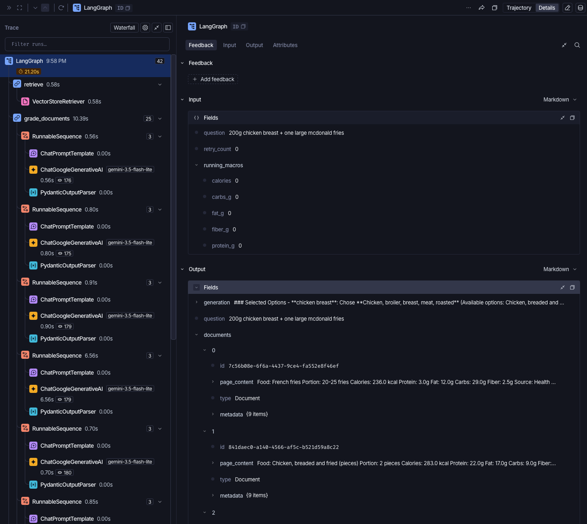
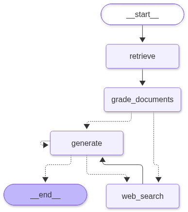
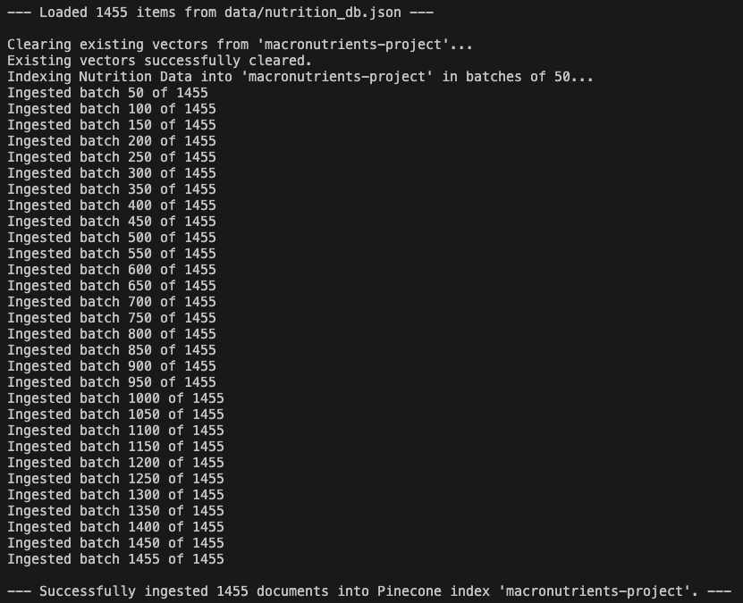
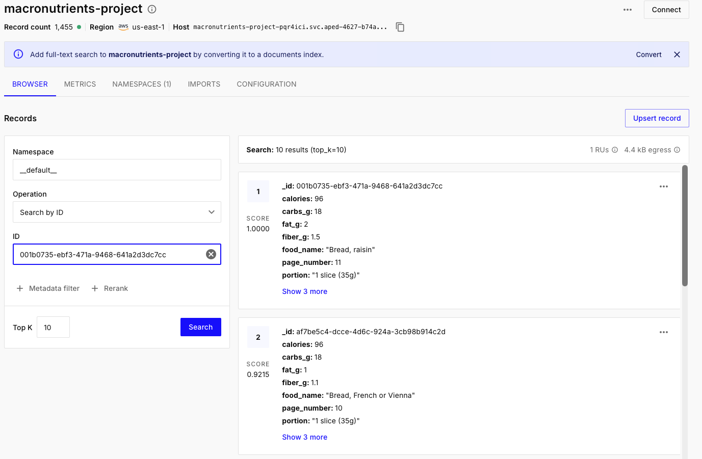

# 🥗 MacroNutrients Agentic RAG


An **Adaptive Retrieval-Augmented Generation (RAG)** agent that calculates accurate macronutrients (calories, protein, carbs, fat, and fiber) for any meal or food item. Built with **LangGraph**, **Gemini 3.5 Flash Lite**, **Pinecone**, **Tavily**, and **FastAPI**, and deployed on **Google Cloud Run**.

* **Live Demo:** https://macronutrients-agent-814923894075.us-east1.run.app
* **Note:** Protected by a demo passkey in the top-right header.

---

## Key Features

* **Retrieval Relevance Grading:** Evaluates every retrieved Pinecone chunk with structured Gemini outputs (`retrieval_grader`) to filter out irrelevant food matches before generation.
* **Dynamic Web Search Fallback:** Automatically routes to Tavily web search (`web_search`) whenever requested foods are missing from the local nutrition knowledge base.
* **Hallucination & Grounding Verification:** Cross-checks generated macro math and food selections against the retrieved source documents (`hallucination_grader`), regenerating if ungrounded claims are detected.
* **Answer Quality & Completeness Check:** Validates that the final response directly and completely answers every item in the user's prompt (`answer_grader`), routing back to web search if gaps remain.
* **Portion Scaling & Meal Aggregation:** Accurately scales reference serving sizes to user-specified weights or quantities and computes summed meal totals.
* **Live Node Streaming:** Streams LangGraph node execution (`retrieve` -> `grade_documents` -> `generate`) in real time via Server-Sent Events (SSE).
* **Session Macro Tracker:** Automatically parses meal totals and updates **Macros of the Day** (`Cal`, `Pro`, `Carb`, `Fat`, `Fiber`) across queries.
* **Source Citations:** Displays exact PDF source names and page numbers (or web URLs) alongside every calculation.

---

## Demo & Observability

### Web Interface


### LangSmith Tracing


---

## System Architecture



1. **Retrieve (`retrieve`):** Queries the `macronutrients-project` Pinecone index for matching foods.
2. **Grade Documents (`grade_documents`):** Filters out irrelevant matches using structured Gemini outputs and flags if a web search is needed.
3. **Web Search Fallback (`web_search`):** Queries Tavily if any requested food is missing from the local database.
4. **Generate (`generate`):** Scales nutritional values to requested portions, sums meal totals, and formats Markdown output with citations.
5. **Hallucination & Answer Quality Loop (`decide_on_hallucination`):** Verifies that calculations are grounded in retrieved documents (`hallucination_grader`) and completely answer the user's prompt (`answer_grader`), retrying generation or triggering a web search before finishing.

---

## Tech Stack

* **LLM & Embeddings:** Google Gemini 3.5 Flash Lite, Google Generative AI Embeddings
* **Agent & Observability:** LangGraph, LangChain, LangSmith
* **Retrieval:** Pinecone, Tavily Search API
* **Backend & Frontend:** FastAPI (SSE), SlowAPI, HTML, Tailwind CSS, JavaScript
* **Cloud & CI/CD:** Docker, `uv`, Google Cloud Run, Cloud Build, Secret Manager

---

## Data Sources & Ingestion (One-Time Setup)

### Reference PDFs
* [Health Canada: Nutrient Value of Some Common Foods](https://www.canada.ca/content/dam/hc-sc/migration/hc-sc/fn-an/alt_formats/pdf/nutrition/fiche-nutri-data/nvscf-vnqau-eng.pdf)
* [FitForFilms: Macros of Common Foods (V3)](https://fitforfilms.com/wp-content/uploads/Macros-of-common-foods-V3.pdf)

### Offline Pipeline
Two one-time scripts in `scripts/` build the vector database from the PDFs above:

1. **PDF Extraction (`scripts/extract_nutrition_data.py`):** Extracts 62 pages of nutritional tables into `data/nutrition_db.json` (**1,455 food items**).
   * 
   * 

2. **Vector Ingestion (`scripts/ingestion.py`):** Embeds and upserts all 1,455 items into Pinecone in batches of 50.
   * 
   * 

---

## Project Structure

```text
MacroNutrients-Project/
├── assets/
│   ├── graph.png                       # Compiled LangGraph architecture diagram
│   ├── Ingestion.png                   # Pinecone batch ingestion log screenshot
│   ├── LangSmith.png                   # LangSmith trace screenshot
│   ├── MacroNutrients Agentic RAG.png  # Live web UI screenshot
│   ├── PDF Processing 1.png            # PDF extraction log (FitForFilms & Health Canada)
│   ├── PDF Processing 2.png            # PDF extraction log (Health Canada completion)
│   └── Pinecone.png                    # Pinecone index dashboard screenshot
├── data/
│   ├── extraction_checkpoint.json      # Page-by-page extraction checkpoint state
│   ├── Macros-of-common-foods-V3.pdf   # Source PDF 1: FitForFilms Macros of Common Foods
│   ├── nutrition_db.json               # 1,455 structured food records extracted from PDFs
│   └── nvscf-vnqau-eng.pdf             # Source PDF 2: Health Canada Nutrient Value of Foods
├── graph/
│   ├── chains/
│   │   ├── __init__.py
│   │   ├── answer_grader.py            # Verifies response answers the user's question
│   │   ├── generation.py               # Calculates scaled macros and formats Markdown
│   │   ├── hallucination_grader.py     # Checks calculations against retrieved documents
│   │   └── retrieval_grader.py         # Evaluates relevance of retrieved food items
│   ├── nodes/
│   │   ├── __init__.py
│   │   ├── generate.py                 # Executes macro generation chain
│   │   ├── grade_documents.py          # Filters retrieved documents and flags web search
│   │   ├── retrieve.py                 # Queries Pinecone vector store
│   │   └── web_search.py               # Runs Tavily fallback search for missing foods
│   ├── __init__.py
│   ├── consts.py                       # Node name constants
│   ├── graph.py                        # StateGraph workflow and conditional routing
│   └── state.py                        # GraphState TypedDict definition
├── scripts/
│   ├── extract_nutrition_data.py       # One-time Gemini PDF-to-JSON extraction script
│   └── ingestion.py                    # One-time Pinecone batch embedding & upsert script
├── src/
│   └── macronutrients_project/         # Package source directory initialized by uv
├── static/
│   ├── app.js                          # SSE stream reader, Markdown parser & macro tracker
│   └── index.html                      # Tailwind CSS dark-mode frontend UI
├── .dockerignore                       # Excludes local env and cache files from Docker build
├── .env                                # Local environment variables (gitignored)
├── .gitignore                          # Git ignore rules
├── .python-version                     # Python version pin (3.11)
├── Dockerfile                          # Production container configuration using uv
├── main.py                             # FastAPI server, SSE endpoint, passkey auth & rate limiter
├── pyproject.toml                      # Project dependencies and metadata
├── README.md                           # Project documentation
└── uv.lock                             # Locked dependency versions
